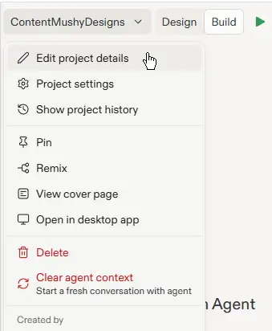
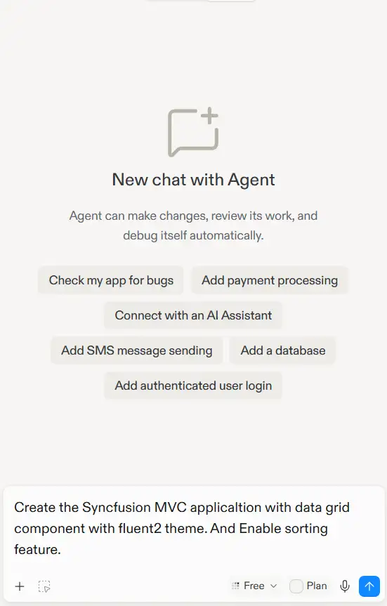
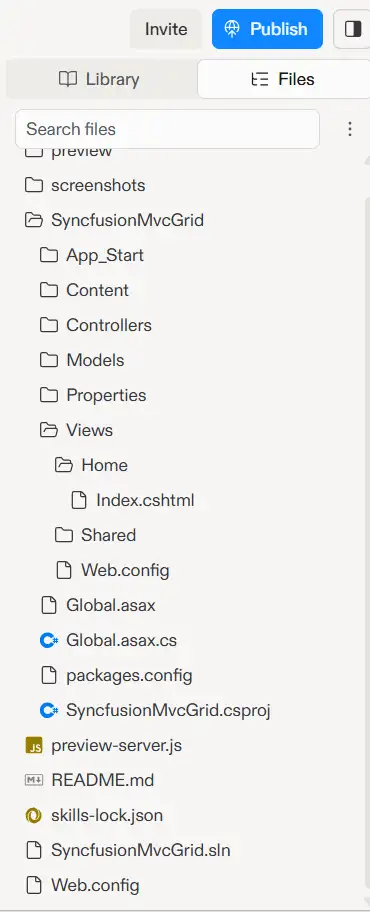
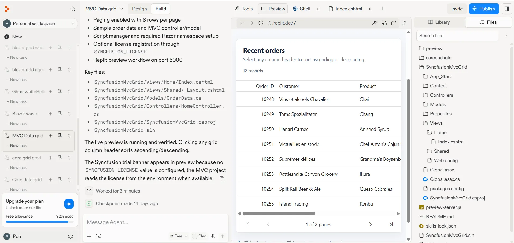

# Getting Started with ASP.NET MVC DataGrid in Replit

This guide explains how to use [Replit](https://replit.com) and Replit Agent to create or edit an [ASP.NET MVC DataGrid](https://www.syncfusion.com/aspnet-mvc-ui-controls/grid) application.

## What is Replit?

[Replit](https://replit.com) is a browser based, AI powered development environment that lets you create and edit application files in the cloud. It is useful for prototyping and AI-assisted code generation.

## Prerequisites

Before you begin, ensure you have:

* A free or paid [Replit account](https://replit.com).
* A configured Syncfusion NuGet package source and a valid [Syncfusion license key](https://ej2.syncfusion.com/aspnetmvc/documentation/licensing/overview), either a trial or a commercial key.

## Create an empty project in Replit

1. Sign in to [Replit](https://replit.com).
2. Click **New** and select **Empty project**.  

3. Replit creates an empty project with a default generated name.
4. To rename the project, click the project name dropdown located at the top of the Replit workspace, select **Edit project details**, and enter a name such as `aspnet-mvc-datagrid`.  

## Create an ASP.NET MVC DataGrid application with Replit

Use Replit Agent to generate or update source files for an ASP.NET MVC application.

Before proceeding, click the **+** icon in the tab bar and select **Shell** from the new tab.

## Install the Syncfusion ASP.NET MVC DataGrid skill

In the Shell tab, run the following command to install the ASP.NET MVC DataGrid [skill](https://github.com/syncfusion/aspnetmvc-ui-components-skills/tree/master/skills/syncfusion-aspnetmvc-grid):




npx skills add syncfusion/aspnetmvc-ui-components-skills --skill syncfusion-aspnetmvc-grid




## Prompt Replit Agent to create the application

Once the skill is installed, Replit Agent can generate the ASP.NET MVC DataGrid application from a prompt. Open the Replit Agent panel and enter a prompt such as:

Example prompt:




Create a Syncfusion ASP.NET MVC application with a DataGrid component. Apply the Fluent2 theme and enable the sorting feature.




The agent will:
- Create ASP.NET MVC source files.
- Add the MVC Grid helper and sample order data.
- Configure the MVC layout with the required Syncfusion resources.

**Review and Modify:** Review the generated code by opening the **Library** panel on the right side. Click the **Files** tab to view the project files. Check `Controllers/HomeController.cs`, `Models/Order.cs`, `Views/Home/Index.cshtml`, `Views/Shared/_Layout.cshtml`, and `Web.config`. You can also press **Ctrl + Shift + L** to quickly toggle the Library panel.

## Run the application

Once Agent finishes generating the application code, click the **Run** button (▶) at the top of the Replit workspace. The ASP.NET MVC DataGrid application will be built and rendered in the preview pane, as shown below.

## Environment variables in Replit

Use Replit Secrets to store sensitive information such as license keys and database URLs:

1. Click the **Secrets** icon (lock icon) in the left sidebar.
2. Add a secret with a key and value (for example, `SYNCFUSION_LICENSE_KEY=your_key_here`).
3. Access the value in ASP.NET MVC using `Environment.GetEnvironmentVariable("SYNCFUSION_LICENSE_KEY")`.

## Publish the application

Replit allows you to publish your application to a live public URL without leaving the browser. To deploy your application:

1. Click the **Publish** button in the top-right corner of the Replit workspace.

    **Note:** Publishing options and availability depend on your Replit plan. Replit automatically recommends the most appropriate publishing option based on your project type. For the latest publishing guidance, refer to the [Replit documentation](https://docs.replit.com/home/publish-the-site).

2. Once publishing is complete, Replit provides a public URL, such as `https://AspNetDataMVCGridApp.<your-username>.replit.app`, that you can share with users.

## Troubleshooting

| Issue | Resolution |
|---|---|
| Syncfusion license warning appears | Verify `SYNCFUSION_LICENSE_KEY` is set on the Windows host and registered in `Application_Start` before any Syncfusion control is initialized. |
| Grid data does not appear | Confirm that the controller assigns the collection to `ViewBag.datasource` and that the Grid binds to the same collection. |

## See also

* [Getting started with the ASP.NET MVC Grid](https://help.syncfusion.com/grid-sdk/asp-net-mvc/data-grid/getting-started-mvc)
* [ASP.NET MVC Grid documentation](https://help.syncfusion.com/grid-sdk/asp-net-mvc/data-grid/overview)
* [Replit documentation](https://docs.replit.com/)
