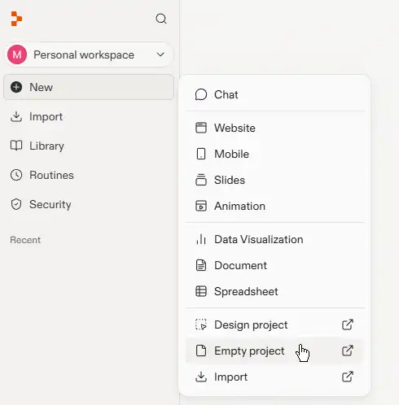
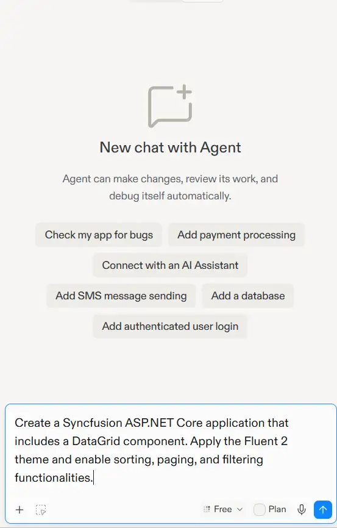
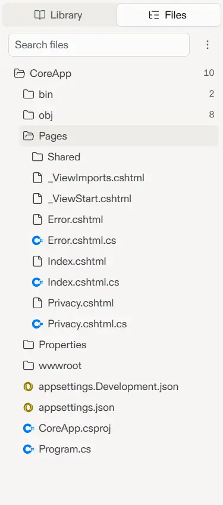
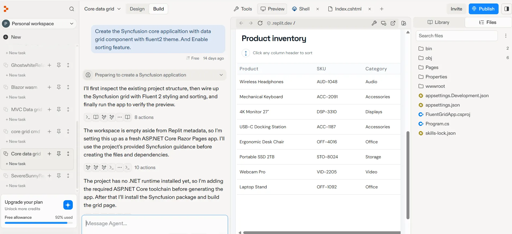
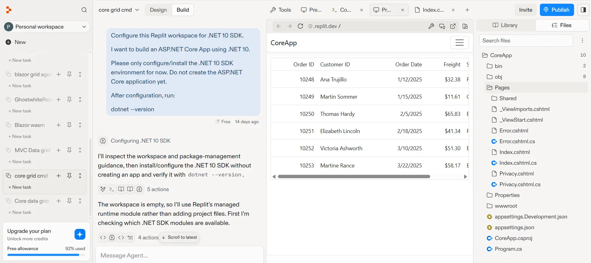

# Getting Started with ASP.NET Core DataGrid in Replit

This guide shows two ways to create an [ASP.NET Core DataGrid](https://www.syncfusion.com/aspnet-core-ui-controls/grid) application in [Replit](https://replit.com):

* **Replit Agent:** Import the ASP.NET Core DataGrid skill and ask Agent to build the application from a prompt.
* **Shell:** Create and configure the ASP.NET Core application manually with .NET CLI commands and code.

Both approaches create an ASP.NET Core Razor Pages application with a DataGrid.

## What is Replit?

[Replit](https://replit.com) is a browser based, AI powered development environment that lets you write, run, and deploy applications entirely in the cloud. It requires no local setup and is well suited for users who are new to software development or who want to prototype and iterate quickly without configuring local development tools.

## Prerequisites

Before you begin, ensure you have:

* A free or paid [Replit account](https://replit.com).
* A Replit environment with the .NET SDK.
* A valid [Syncfusion license key](https://ej2.syncfusion.com/aspnetcore/documentation/licensing/overview), either a trial or a commercial key.

## Create an empty project in Replit

1. Sign in to [Replit](https://replit.com).
2. Click **New** and select **Empty project**.  

3. Replit creates an empty project with a default generated name.
4. To rename the project, click the project name dropdown located at the top of the Replit workspace, select **Edit project details**, and enter a name such as `datagrid-app`.  

## Create an ASP.NET Core DataGrid Application in Replit

This section explains how to add a simple ASP.NET Core DataGrid application to the current Replit project and integrate the DataGrid component with the minimum required setup using either of the following approaches.

Before proceeding, click the **+** icon in the tab bar and select **Shell** from the new tab. The Shell is required for both the Agent and .NET CLI approaches described in the following sections.





## Install the Syncfusion ASP.NET Core DataGrid skill

In the Shell tab, run the following command to install the ASP.NET Core DataGrid [skill](https://github.com/syncfusion/aspnetcore-ui-components-skills/tree/master/skills/syncfusion-aspnetcore-grid):




npx skills add syncfusion/aspnetcore-ui-components-skills --skill syncfusion-aspnetcore-grid




## Use Replit Agent to create the application

Once the skill is installed, Replit Agent can generate the ASP.NET Core DataGrid application from a prompt. Open the Replit Agent panel and enter a prompt such as:

Example prompt:




Create a Syncfusion ASP.NET Core application that includes a DataGrid component. Apply the Fluent 2 theme and enable sorting, paging, and filtering functionalities.




The agent will:
- Create an ASP.NET Core Razor Pages application with .NET 10.
- Install the required Syncfusion package.
- Add the Fluent 2 stylesheet and the EJ2 JavaScript references.
- Configure the Syncfusion DataGrid and sample order data.
- Configure the application to use the Replit port.

**Review and Modify:** Review the generated code by opening the **Library** panel on the right side. Click the **Files** tab to view all project files. Then, click files such as `Pages/Index.cshtml`, `Pages/Shared/_Layout.cshtml`, and `Program.cs` to view and edit the generated code if needed. You can also press **Ctrl + Shift + L** to quickly toggle the Library panel.

## Run the Application

Once Agent finishes generating the application code, click the **Run** button (▶) at the top of the Replit workspace. The ASP.NET Core DataGrid application will be built and rendered in the preview pane, as shown below.





## Verify the .NET version

Verify the .NET version by running `dotnet --info` in the Shell tab.

If the .NET SDK is not available in your Replit workspace, use the prompt below to install the required .NET version. In this example, we use .NET 10.




Configure this Replit workspace for .NET 10 SDK.

I want to build an ASP.NET Core App using .NET 10.

Please only configure/install the .NET 10 SDK environment for now.
Do not create the ASP.NET Core application yet.

After configuration, run:

dotnet --version

and show me the result.




## Create an ASP.NET Core Razor Pages application

Open the **Shell** tab and create an ASP.NET Core Razor Pages application:




dotnet new webapp -o AspNetCoreDataGridApp
cd AspNetCoreDataGridApp




Replace `AspNetCoreDataGridApp` with your preferred project name.

## Install the Syncfusion ASP.NET Core package

Install the ASP.NET Core DataGrid and theme packages using the same Syncfusion release version:




dotnet add package Syncfusion.AspNetCore.Grid --version {{ site.releaseversion }}
dotnet add package Syncfusion.AspNetCore.Themes --version {{ site.releaseversion }}
dotnet restore




For details about Syncfusion ASP.NET Core package options, see [NuGet packages](https://ej2.syncfusion.com/aspnetcore/documentation/nuget-packages).

## Import the required tag helpers

After the package is installed, open the **~/Pages/_ViewImports.cshtml** file and import the `Syncfusion.AspNetCore.Base` and `Syncfusion.AspNetCore.Grid` Tag Helpers.




@addTagHelper *, Syncfusion.AspNetCore.Base
@addTagHelper *, Syncfusion.AspNetCore.Grid




## Add the theme and script references

The theme stylesheet and script can be referenced from [CDN](https://ej2.syncfusion.com/aspnetcore/documentation/appearance/theme#cdn-reference). Include the [stylesheet](https://ej2.syncfusion.com/aspnetcore/documentation/appearance/theme) and [script references](https://ej2.syncfusion.com/aspnetcore/documentation/common/adding-script-references) inside the `<head>` of **~/Pages/Shared/_Layout.cshtml**




<head>
    ...
    <!-- ASP.NET Core controls styles -->
    <link rel="stylesheet" href="_content/Syncfusion.AspNetCore.Themes/styles/fluent2.css" />
    <!-- ASP.NET Core controls scripts -->
    
</head>




Register the Syncfusion script manager before the closing `</body>` tag in the same file:




<ejs-scripts></ejs-scripts>




## Add the Syncfusion ASP.NET Core DataGrid

Open `Pages/Index.cshtml` and replace its contents with the following example:




@page
@model IndexModel
@{
    ViewData["Title"] = "Home page";
}

@{
    List<Order> orders = new List<Order>
    {
        new Order(10248, "Ana Trujillo", new DateTime(2025,1,12), "France", 32.38),
        new Order(10249, "Martin Sommer", new DateTime(2025,1,15), "Germany", 11.61),
        new Order(10250, "Thomas Hardy", new DateTime(2025,2,5), "Brazil", 65.83),
        new Order(10251, "Elizabeth Lincoln", new DateTime(2025,2,18), "France", 41.34),
        new Order(10252, "Victoria Ashworth", new DateTime(2025,3,10), "Belgium", 51.30),
        new Order(10253, "Martine Rance", new DateTime(2025,3,22), "Brazil", 58.17)
    };
}

<ejs-grid id="Grid" dataSource="@orders">
    <e-grid-columns>
        <e-grid-column field="OrderID" headerText="Order ID" textAlign="Right" width="120"></e-grid-column>
        <e-grid-column field="CustomerID" headerText="Customer ID" width="150"></e-grid-column>
        <e-grid-column field="OrderDate" headerText="Order Date" width="130" textAlign="Right" format="yMd"></e-grid-column>
        <e-grid-column field="Freight" headerText="Freight" width="100" textAlign="Right" format="C2"></e-grid-column>
        <e-grid-column field="ShipCountry" headerText="Ship Country" width="120"></e-grid-column>
    </e-grid-columns>
</ejs-grid>





namespace CoreApp.Pages;

public class IndexModel : PageModel
{
    public void OnGet()
    {

    }
}
public class Order
{
    public Order() { }
    public Order(int id, string customer, DateTime date, string country, double freight)
    {
        this.OrderID = id;
        this.CustomerID = customer;
        this.OrderDate = date;
        this.ShipCountry = country;
        this.Freight = freight;
    }

    public int? OrderID { get; set; }
    public string CustomerID { get; set; }
    public DateTime? OrderDate { get; set; }
    public string ShipCountry { get; set; }
    public double? Freight { get; set; }
}





## Run the application

In the Shell tab, run this command from the project directory:




dotnet run --urls "http://0.0.0.0:${PORT:-3000}"




Otherwise, click the **Run** button (▶) at the top of the Replit workspace.

The ASP.NET Core DataGrid application will be built and rendered in the preview pane, as shown below.





## Environment Variables in Replit

Use Replit Secrets to store sensitive information such as license keys and database URLs:

1. Click the **Secrets** icon (lock icon) in the left sidebar.
2. Add a secret with a key and value (for example, `SYNCFUSION_LICENSE_KEY=your_key_here`).
3. Access the value in ASP.NET Core using `Environment.GetEnvironmentVariable("SYNCFUSION_LICENSE_KEY")`.

## Publish the Application in Replit

Replit allows you to publish your application to a live public URL without leaving the browser. To deploy your application:

1. Click the **Publish** button in the top-right corner of the Replit workspace.

    **Note:** Publishing options and availability depend on your Replit plan. Replit automatically recommends the most appropriate publishing option based on your project type. For the latest publishing guidance, refer to the [Replit documentation](https://docs.replit.com/home/publish-the-site).

2. Once publishing is complete, Replit provides a public URL, such as `https://AspNetCoreDataGridApp.<your-username>.replit.app`, that you can share with users.

## Troubleshooting

| Issue | Resolution |
|---|---|
| `dotnet` command is not found | Select or configure a Replit environment with the .NET SDK, then verify it by running `dotnet --info`. |
| The preview cannot connect to the app | Confirm that the app is running and listening on `0.0.0.0` using the port provided by Replit. |
| Syncfusion license warning appears | Verify that `SYNCFUSION_LICENSE_KEY` is set in Replit Secrets and that license registration runs in `Program.cs` before the app is built. |
| Grid is unstyled | Confirm that the Fluent 2 stylesheet reference is in `Pages/Shared/_Layout.cshtml` and that the `Syncfusion.AspNetCore.Themes` package is installed. |
| Grid is visible but not interactive | Verify that the DataGrid script reference and `<ejs-scripts>` tag are present in `Pages/Shared/_Layout.cshtml`. |
| Package restore fails | Check the package name and version in the project file, then run `dotnet restore` in the project directory. |

## See also

* [Getting started with the ASP.NET Core DataGrid](https://ej2.syncfusion.com/aspnetcore/documentation/getting-started/razor-pages)
* [ASP.NET Core DataGrid documentation](https://help.syncfusion.com/grid-sdk/asp-net-core/data-grid/overview)
* [Syncfusion ASP.NET Core DataGrid skills](https://github.com/syncfusion/aspnetcore-ui-components-skills/tree/master/skills/syncfusion-aspnetcore-grid)
* [Replit Agent Skills](https://docs.replit.com/features/agent/skills)
* [Replit documentation](https://docs.replit.com/)
